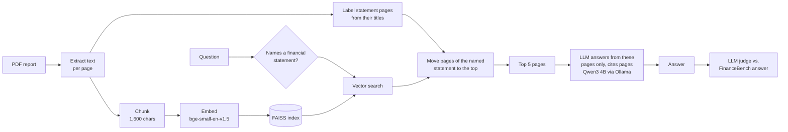

# Financial Report Q&A (RAG on FinanceBench)

A question-answering system for company financial reports (10-K, 10-Q, 8-K), built from scratch and **measured at every step** on the [FinanceBench](https://github.com/patronus-ai/financebench) benchmark: 150 analyst questions over 84 real filings.

It runs **fully locally**: the embedding model, the vector index and the LLM (Qwen3 4B via Ollama) all run on a laptop, so no document or question leaves the machine.

```text
Q: What is the FY2018 capital expenditure amount (in USD millions) for 3M?
   Give a response to the question by relying on the details shown in the
   cash flow statement.

A: The FY2018 capital expenditure amount for 3M is $1,577 million.
   Page 60 states: "Purchases of property, plant and equipment (PP&E)
   $ (1,577) $ (1,373) $ (1,420)"                              (page 60)
```

## Results

**Retrieval** (all 150 questions): does the system find the page that contains the answer?

| Method | Correct page ranked 1st | In top 5 | In top 10 | MRR@10 |
|---|---|---|---|---|
| BM25 (keywords) | 16.0% | 27.3% | 32.0% | 0.210 |
| FAISS (embeddings) | 26.7% | 56.7% | 69.3% | 0.387 |
| **FAISS + statement boost** (this project) | **40.0%** | **64.0%** | **75.3%** | **0.503** |

**End-to-end answers** (graded by an LLM judge): **46% correct** overall, **68%** on direct metric questions.
This was measured on a partial run of 68 of the 150 questions (companies A–C), so treat it as an estimate.

| Question type | Example | Correct |
|---|---|---|
| Metric extraction / calculation | "Amazon's revenue growth FY2016→FY2017?" | 68% (15/22) |
| Analyst reasoning | "What drove AMD's operating margin change?" | 38% (11/29) |
| Open-ended | "Is Boeing's business subject to cyclicality?" | 29% (5/17) |

## How it works



1. **Extract & chunk.** PyMuPDF extracts each page's text; pages are split into 1,600-character chunks (300 overlap) so each chunk fits the embedding model's 512-token window. Chunks never cross pages, so every result maps to a page number.
2. **Search.** Questions and chunks are embedded with `bge-small-en-v1.5` (with BGE's query instruction) and matched in a FAISS inner-product index.
3. **Statement boost.** Many analyst questions say where the answer is ("...based on the cash flow statement"). Pages are labeled as cash flow statement, balance sheet or income statement from their titles; when a question names a statement, those pages move to the top. This is the change that lifted page-1 accuracy from 27% to 40%.
4. **Answer.** The full text of the top 5 pages goes to the LLM with instructions to use only those pages, show calculations, cite pages, and reply "Not found" rather than guess.
5. **Judge.** A second LLM call compares the answer with FinanceBench's reference answer and returns CORRECT / INCORRECT with a reason. Answers are free text ("$1,577 million" vs "$1577.00"), so string matching does not work.

## What I tried, and what the data said

Every idea was run on all 150 questions and kept only if it beat the baseline.

| Experiment | Result | Kept? |
|---|---|---|
| Score unique pages instead of chunks | Fixed the metric: 3 chunks of one page used to fill 3 of the "top 10" slots | ✅ |
| Chunk size 1,600 vs 3,200 vs whole page | All within ~1 point (68–69% top 10) | 1,600 |
| Cross-encoder reranker (`bge-reranker-base`) | **Worse**: top 10 dropped 69% → 65%, page-1 accuracy 27% → 22% | ❌ |
| Hybrid search (BM25 + FAISS, reciprocal rank fusion) | **Worse**: BM25 alone only finds 32%; fusing it pulled in wrong pages (51%) | ❌ |
| Financial statement boost | **Better**: page-1 accuracy 27% → 40%, top 10 69% → 75%; 9 questions gained, none lost | ✅ |

## Error analysis

From the 68 judged answers:

- **Most errors come from search, not the LLM.** When the correct page reached the LLM, 66% of answers were correct; when it did not, only 20% were. 24 of the 37 wrong answers had never seen the right page.
- **The model does not invent numbers.** 29 answers were "Not found in the provided pages" instead of a guess, which is the safe failure mode for financial data, but it also means some answerable questions were missed.
- **The judge is reliable.** In a manual check of 10 random verdicts, I agreed with the judge on all 10.
- **The metric is conservative.** FinanceBench marks one page as correct, but figures often repeat (3M's capex appears on pages 46, 49 and 60), so some retrieval "misses" still contain the answer. The answer-level judge captures these.

## Run it

Requires Python 3.9+ and [Ollama](https://ollama.com).

```bash
python -m venv .venv && source .venv/bin/activate
pip install -r requirements.txt
ollama pull qwen3:4b-instruct
```

**Data** (not in the repo, ~670 MB of PDFs): clone [FinanceBench](https://github.com/patronus-ai/financebench), copy `pdfs/*.pdf` into `data/raw/` and `data/financebench_open_source.jsonl` into `data/processed/`.

```bash
# Ask a question about one report
python -m src.generation.answer --pdf data/raw/APPLE_2022_10K.pdf --question "..."

# See which pages the search finds (add --all-methods to compare methods)
python -m src.retrieval.search --pdf data/raw/3M_2018_10K.pdf --question "..."

# Retrieval evaluation (~10 min) and comparison of saved experiments
python -m src.retrieval.evaluate --name my_run
python -m src.retrieval.compare

# Answer + judge evaluation (~1 min per question on an M4 laptop)
python -m src.generation.evaluate_answers --limit 10
```

All settings (chunk size, models, number of pages) are in [`src/config.py`](src/config.py).

## Project structure

```text
src/
├── config.py               all settings in one place
├── ingestion/
│   ├── extractor.py        PDF → text per page
│   └── chunker.py          pages → overlapping chunks
├── retrieval/
│   ├── embeddings.py       bge-small embeddings (query instruction for BGE)
│   ├── vector_store.py     FAISS index and search
│   ├── statements.py       financial statement detection and boost
│   ├── bm25_search.py      keyword search (baseline)
│   ├── hybrid_search.py    reciprocal rank fusion (experiment)
│   ├── reranker.py         cross-encoder reranking (experiment)
│   ├── pipeline.py         build indexes, run every method
│   ├── search.py           CLI: search one report
│   ├── evaluate.py         retrieval metrics on FinanceBench
│   └── compare.py          side-by-side table of experiments
└── generation/
    ├── llm.py              local LLM client (Ollama)
    ├── answer.py           retrieve pages → grounded answer with citations
    ├── judge.py            LLM-as-a-judge grading
    └── evaluate_answers.py answer + judge every question
```

## Limitations and next steps

- **Analyst-style questions** ("Is 3M capital-intensive?") use no words from the pages that answer them; they fail retrieval about half the time. Next: have the LLM rewrite them into the line items to look up (capex, PP&E, total assets).
- **Pages 6–10 are never read.** The correct page is in the top 10 for 75% of questions but in the top 5 for only 64%. Next: give the LLM 10 pages.
- **One document at a time.** Each question is asked against its own report. A production system would first find the right report among all of them.
- **Partial answer evaluation.** The end-to-end numbers cover 68 of 150 questions; the full run takes over 2 hours locally.
- **Small local model.** Qwen3 4B keeps everything private and free but limits multi-step reasoning.
